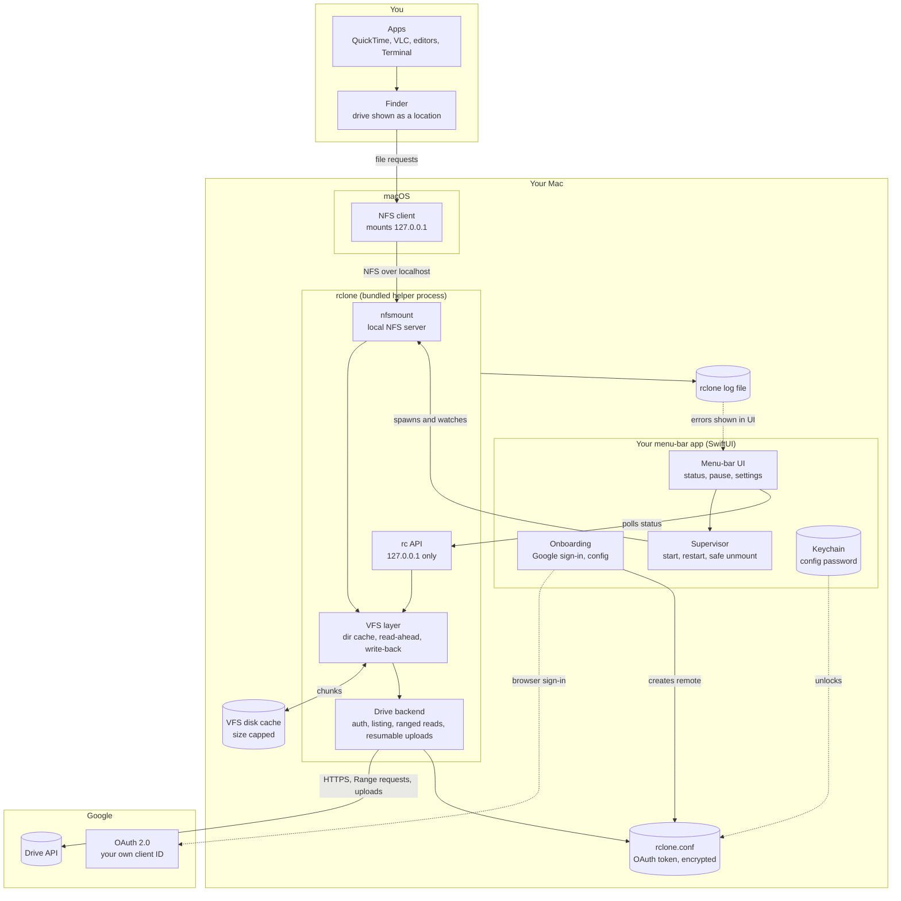
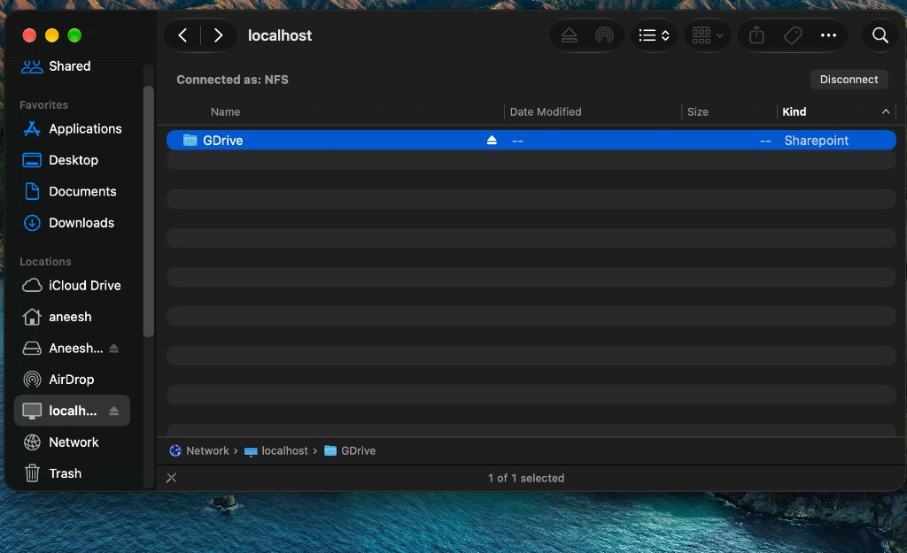
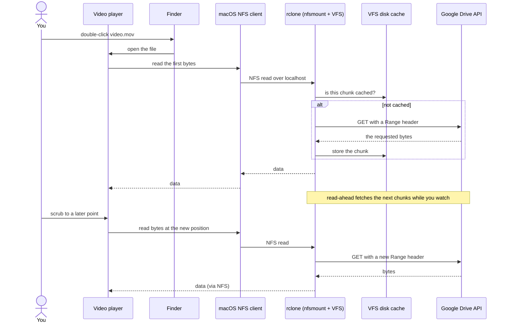
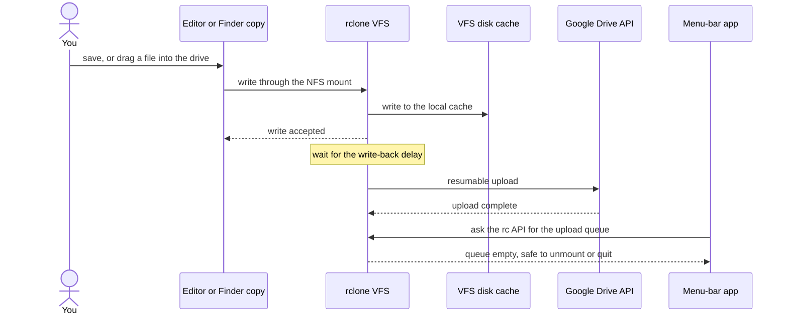

# Horizon: Full Plan and Architecture

Oct 29, 2026 · @Aneesh

Horizon is a small macOS menu-bar app that launches rclone to mount your Google Drive in Finder, streams files on demand, and shows you the drive's health. rclone does the hard parts (Drive access, ranged reads, disk cache, resumable uploads); your app supervises it and presents it. A custom Apple filesystem extension stays as an optional last stage if rclone's Finder behavior is not good enough.

## Architecture

Finder talks to a local NFS server run by rclone, and rclone talks to Google Drive; your app only starts, watches and displays it.



**How to read it**

- **File data never passes through your app.** Finder reads and writes go to macOS's NFS client, then to rclone's local server, then to Drive. Your app is only the control panel.
- **rclone owns the hard parts:** the Drive login token, the folder-listing cache, the on-disk chunk cache, read-ahead, write-back and resumable uploads.
- **Your app owns the experience:** first-run sign-in, starting and restarting rclone, safe unmounting, status from the `rc` API, and error messages from the log.
- **Swappable later:** a custom Finder extension would replace the macOS NFS client, rclone's NFS server and the VFS layer, while the menu-bar app stays.

The diagram is Mermaid source. If your viewer shows it as code, paste it into mermaid.live to see it drawn.

## Stages and gates

There are ten stages with two gates; the first gate decides whether rclone is good enough before you build any app around it.

```mermaid
flowchart LR
  S0["Stage 0<br/>Setup<br/>Google project, OAuth client, official rclone"]
  S1["Stage 1<br/>Prove it in Terminal<br/>nfsmount plus real test files"]
  G1{"Gate 1<br/>Big video plays and<br/>Finder stays responsive?"}
  PLANB["Plan B<br/>FUSE-T mount, or custom<br/>Finder extension"]
  S2["Stage 2<br/>Tune flags<br/>measure, then lock settings"]
  S3["Stage 3<br/>Menu-bar shell<br/>launch and supervise rclone"]
  S4["Stage 4<br/>Onboarding<br/>sign-in, config, Keychain"]
  S5["Stage 5<br/>Finder integration<br/>mount point, sidebar, safe eject"]
  S6["Stage 6<br/>Status and control<br/>rc API: speed, queue, refresh"]
  G2{"Gate 2<br/>Survives sleep, offline<br/>and a crash with no data loss?"}
  S7["Stage 7<br/>Hardening and packaging<br/>notarize, login item, updates"]
  S8["Stage 8 (optional)<br/>Pinned folders<br/>and code backup"]
  S9["Stage 9 (optional)<br/>Custom Finder extension<br/>if rclone falls short"]

  S0 --> S1 --> G1
  G1 -->|"yes"| S2
  G1 -->|"no"| PLANB
  S2 --> S3 --> S4 --> S5 --> S6 --> G2
  G2 -->|"yes"| S7
  G2 -->|"no, fix and retest"| S6
  S7 --> S8 --> S9
  PLANB -.-> S9
```



Each stage ends with something you can run and check, so you always have a working tool: after stage 1 you already have a usable (if manual) Drive mount, and every later stage makes it safer and easier to live with.

## Step-by-step plan: stages 0 to 4

Stages 0 to 2 happen in Terminal and tell you whether the idea works; stages 3 and 4 turn it into an app.

### Stage 0: Setup

Goal: have Google credentials and the right rclone binary.

1. In Google Cloud, create a project and enable the Drive API.
2. Set up the OAuth consent screen and create an OAuth client of type Desktop. Note the client ID and secret.
3. Publish the consent screen "In production" (unverified is fine for just you). Apps left in Testing mode have refresh tokens that expire after 7 days.
4. Download the official rclone binary from rclone.org. The Homebrew build has historically lacked some mount features, so prefer the official one.
5. Check that your version supports NFS mounting: run `rclone version`, then `rclone nfsmount --help`. It arrived around version 1.65, so use a recent release.

**Done when:** both commands run without errors and you have a client ID and secret.

### Stage 1: Prove it in Terminal

Goal: find out how Drive feels through rclone before writing any app code.

1. Create the remote: `rclone config create gdrive drive client_id=<id> client_secret=<secret> scope=drive`. A browser opens for Google sign-in.
2. Check it works: `rclone lsd gdrive:` should list your top-level folders.
3. Make a mount folder (`mkdir ~/GDrive`) and mount with the command in the flags section below.
4. Open the folder in Finder, then run these tests: play a large video in QuickTime, VLC and IINA and scrub through it; copy a multi-GB file in and out; edit and save a text file; open a Google Doc; sleep and wake the Mac; turn Wi-Fi off and on.
5. Break it on purpose: stop rclone with `kill`, see what Finder does, then recover with `umount -f ~/GDrive`.
6. Write down results per app: time to first frame, stalls, copy speed, any Finder freeze.

**Done when (Gate 1):** a large video starts within a few seconds and scrubs well, Finder never hangs for more than a few seconds, and you can recover from a killed rclone. If not, go to Plan B in the risks section.

#### Stage 1 Test Results & Findings (Oct 29, 2026)

**Gate 1 Outcome:** **PASSED (Green Light)** — Proceed with `rclone nfsmount` into Stage 2. Plan B (FUSE-T / custom filesystem extension) is not needed.



##### 1. Finder & Mount Behavior
* **Mount Point:** Appeared in Finder under **Locations** as `localhost` (`Connected as: NFS`).
* **Sharepoint:** `GDrive` showed up as an accessible network sharepoint (`Network > localhost > GDrive`).
* **Responsiveness:** Finder remained fully responsive without hangs during directory traversal, streaming, and file manipulation.

##### 2. Video Playback (QuickTime & VLC)
* **Status:** Videos loaded and played successfully in both **QuickTime Player** and **VLC**.
* **Observation:** Noticeable initial latency before playback begins ("takes some time initially but loads"). Once buffered, playback is smooth.
* **Action for Stage 2 Tuning:** Experiment with `--vfs-read-ahead` (currently `256M`), `--buffer-size` (currently `64M`), and `--vfs-read-chunk-size` / `--vfs-read-wait` to reduce time-to-first-frame.

##### 3. File I/O & Cache Throughput (2 GB Test File)
* **File Generation:** 2 GB (`2,147,483,648 bytes`) via `/dev/urandom` in 4.07s (~527 MB/s).
* **Write to Mount (`cp /tmp/test_2gb.dat ~/GDrive/test_2gb.dat`):**
  * Time: `14.185s total` (~151 MB/s into VFS disk cache).
  * System load: Minimal (5% CPU, 0.81s system, 0.00s user).
* **Read from Mount (`cp ~/GDrive/test_2gb.dat /tmp/test_out.dat`):**
  * Time: `13.980s total` (~153 MB/s read from local VFS disk cache).
  * System load: Minimal (6% CPU, 0.92s system, 0.00s user).
* **In-Place Edits & Deletion:**
  * In-place append (`echo "Testing write capability" >> ~/GDrive/horizon_test.txt`) succeeded instantly and read back accurately via `cat`.
  * Deleting the file immediately cleaned up the corresponding VFS cache entry.

##### 4. VFS Cache & Background Upload Pipeline (Log Verification)
* rclone logs (`~/Library/Logs/Horizon/rclone.log`) confirmed proper background write-back:
  * Delayed upload trigger (5s): `test_2gb.dat: vfs cache: queuing for upload in 5s`.
  * Drive upload success: `horizon_test.txt: Copied (new)`, `vfs cache: upload succeeded try #1`.
  * Cache lifecycle on delete: `horizon_test.txt: vfs cache: removed cache file as file deleted`.
  * Automatic cache sweep: `Google drive root '': vfs cache: cleaned: objects 75 (was 75) in use 1, to upload 0, uploading 1, total size 2.242Gi`.

##### 5. rclone `rc` API Interaction Gotcha
* **Finding:** Calling `curl -u app:secret123 http://127.0.0.1:5572/core/stats` and `/vfs/queue` returned `404 Not Found`.
* **Root Cause:** rclone's `rc` HTTP endpoints require `POST` requests, not default `GET`.
* **Resolution for Stage 6 / App:** Use `POST` requests (e.g. `curl -X POST -u ...` or `curl -d "" -u ...`). In Swift (`URLSession`), ensure `request.httpMethod = "POST"`.

##### 6. Crash Recovery & Unmount Stability
* **Simulated Crash:** Force-killed with `pkill -9 -f "rclone nfsmount"`.
* **Recovery:** Finder did not hang. Stale mount was cleanly and immediately detached using `umount -f ~/GDrive`.
* **Verification:** `mount | grep GDrive` returned clean (no lingering mount points or lockups).

### Stage 2: Tune the settings

Goal: lock in a flag set you trust.

1. Adjust one setting at a time: cache size, read-ahead, directory cache time, poll interval, write-back delay.
2. For each change, repeat the video start and copy tests and record the numbers in a small table.
3. Choose how Google Docs, Sheets and Slides appear: exported to Office formats, or as small link files (see the flags section).
4. If Google throttles you, add a transactions-per-second limit.
5. Save the final flags in one text file; the app will read them in stage 3.

**Done when:** you have a final flag list and a measurements table you are happy with.

### Stage 3: Menu-bar shell

Goal: an app that starts, stops and supervises rclone for you.

1. Create a SwiftUI macOS app with `MenuBarExtra`, and set it to run as a menu-bar-only app (no Dock icon).
2. Put the rclone binary inside the app bundle and code-sign it with the hardened runtime, the same as the app.
3. Launch rclone with Foundation's `Process`, passing your saved flags, and capture its output to a log file.
4. Build a supervisor: if rclone exits unexpectedly, unmount cleanly and restart it, with a delay that grows after repeated failures.
5. Show a simple state in the menu: Stopped, Starting, Mounted, Error.
6. Add "Start at login" with `SMAppService`.

**Done when:** clicking Start mounts the drive in Finder, and killing rclone makes the app recover on its own.

### Stage 4: Onboarding and config

Goal: a first-run flow that needs no Terminal.

1. On first launch, ask for your Google client ID and secret and run `rclone config create` as a subprocess. rclone opens the browser for sign-in.
2. Keep the config in your app's own folder under Application Support and pass it with `--config`.
3. Encrypt the config file with rclone's config encryption, keep the password in the Keychain, and let rclone read it through its password-command option, so no secret sits in plain text.
4. Watch the log for sign-in errors. If the token expires or is revoked, show a Reconnect button that runs `rclone config reconnect`.

**Done when:** you can delete the config, launch the app, sign in, and see Drive mounted without opening Terminal.

## Step-by-step plan: stages 5 to 9

Stages 5 to 7 make the drive pleasant and safe to rely on; stages 8 and 9 are optional.

### Stage 5: Finder integration

Goal: the drive shows up and goes away cleanly, the way a normal disk does.

1. Mount at a fixed folder such as `~/GDrive`, and give the volume a friendly name with `--volname` if your rclone version supports it.
2. Check whether the mount appears under Locations in Finder. If it does not, drag the folder into the Finder sidebar yourself; Apple's programmatic sidebar API is deprecated, so I would not build on it.
3. Add "Open in Finder" and "Unmount" to the menu.
4. Make unmounting safe: ask rclone for its upload queue, wait until it is empty (with a time limit and a warning), unmount, and only then stop rclone.
5. On app launch, detect a stale mount left by a crash and force-unmount it before starting again.
6. Optional: Finder writes `.DS_Store` files into network folders; the macOS setting `DSDontWriteNetworkStores` stops that.

**Done when:** mounting, opening, unmounting and relaunching after a crash all work from the menu with no leftover mount.

### Stage 6: Status and control

Goal: see what rclone is doing and steer it from the menu.

1. Start rclone with its remote-control (`rc`) API on `127.0.0.1` only, with a random username and password generated at each launch.
2. Poll `core/stats` every few seconds for transfer speed, active transfers and errors, and `vfs/queue` for pending uploads.
3. Add menu actions: Refresh now (`vfs/refresh`), a bandwidth limit (`core/bwlimit`), and Clear cache (stop, delete the cache folder, restart; refuse if uploads are queued).
4. Turn known log errors into short messages: offline, quota reached, sign-in expired.
5. Run the gate-2 tests: sleep and wake, offline during an upload, `kill -9` on rclone, and an unplanned restart.

**Done when (Gate 2):** the menu shows live speed and pending uploads, and none of the gate-2 tests loses or corrupts a file.

### Stage 7: Hardening and packaging

Goal: a week of daily use without rescuing it by hand.

1. Limit crash-loop restarts and show a clear error instead of retrying forever.
2. On wake from sleep, check mount health with a `stat` on a background thread and a timeout. If it hangs, force-unmount and remount.
3. Show an Offline state when the network drops, and warn if the cache cap is larger than your free disk space.
4. Add a log viewer and a Copy diagnostics button.
5. For your own Mac, local signing is enough. To run it on other Macs, sign with a Developer ID, enable the hardened runtime and notarize both the app and the bundled rclone.
6. Update rclone by replacing the bundled binary, then rerun the stage 1 tests. Ship rclone's MIT license text inside the app.

**Done when:** you have used it for a week without needing Terminal.

### Stage 8 (optional): Pinned folders and code projects

Goal: handle the case a streamed mount is bad at.

1. Keep active repos on local disk, and back them up to Drive on a schedule with `rclone copy` or `rclone sync` plus a filter file that excludes `node_modules/**`, `.venv/**`, `build/**` and `DerivedData/**`.
2. For two-way offline folders, evaluate `rclone bisync`; check its current maturity in the docs first.
3. Always do a `--dry-run` first and set `--max-delete` so a mistake cannot wipe a folder.
4. In the app, list pinned folders with last-sync time, a Sync now button and any error.

**Done when:** a repo backs up on a schedule and a dry run shows no surprise deletes.

### Stage 9 (optional): Custom Finder extension

Goal: replace the mount layer only if rclone's Finder behavior is not good enough.

1. Do this only if gates 1 and 2 show freezes, poor thumbnails or similar problems you cannot tune away.
2. Follow the extension and engine design in [the main build plan](https://claude.ai/artifact/UhYe13QkxG99HuocG6zQau).
3. Keep the menu-bar app, onboarding and status UI; swap rclone's NFS server and cache for your own extension and engine.

**Done when:** the custom mount passes the same gate-1 and gate-2 tests as rclone did.

## How a file read and a file save flow

A read fetches only the bytes the app asks for, and a save lands in the local cache first and uploads in the background.

**Opening and playing a video**



**Saving or dragging a file in**



The second diagram is why the app must wait for an empty upload queue before unmounting: until then, the only full copy of a new file may be in the local cache.

## Starting command and flags

Start from this command in stage 1, then tune it in stage 2. Flag names and defaults change between rclone releases, so check each against `rclone nfsmount --help` for your version.

```bash
rclone nfsmount gdrive: ~/GDrive \
  --volname "Google Drive" \
  --vfs-cache-mode full \
  --cache-dir ~/Library/Caches/Horizon/rclone \
  --vfs-cache-max-size 20G \
  --vfs-cache-max-age 24h \
  --vfs-read-ahead 256M \
  --vfs-write-back 5s \
  --dir-cache-time 5m \
  --poll-interval 30s \
  --buffer-size 64M \
  --drive-chunk-size 64M \
  --drive-export-formats webloc \
  --nfs-cache-type disk \
  --rc --rc-addr 127.0.0.1:5572 --rc-user app --rc-pass <random per launch> \
  --log-file ~/Library/Logs/Horizon/rclone.log --log-level INFO
```

| Flag | Starting value | What it does | Tune it by |
| --- | --- | --- | --- |
| `--vfs-cache-mode` | `full` | Keeps file chunks on disk so reads and saves behave like a normal disk | Required for streaming and for apps that save in place |
| `--vfs-cache-max-size` | 20G | Caps the on-disk cache; rclone removes the oldest data | Your free disk space |
| `--vfs-cache-max-age` | 24h | How long untouched cached data stays | Disk space versus re-downloads |
| `--vfs-read-ahead` | 256M | Extra data fetched ahead of what the app has read | Time to first frame and playback stalls |
| `--buffer-size` | 64M | Memory buffer per open file | Your RAM |
| `--vfs-write-back` | 5s | Delay before a saved file starts uploading | Lower is faster to Drive; higher avoids re-uploading files saved repeatedly |
| `--dir-cache-time`, `--poll-interval` | 5m, 30s | How long folder listings are trusted, and how often Drive changes are checked | How fresh Finder must be versus API use |
| `--drive-chunk-size` | 64M | Upload chunk size; bigger is faster and uses more memory | Upload speed versus RAM |
| `--drive-export-formats` | `webloc` | Shows Google Docs, Sheets and Slides as clickable link files; leave at the default to export Office files instead | Whether you want to open them on the Mac or in the browser |
| `--nfs-cache-type` | `disk` | Lets file handles survive an rclone restart, so Finder recovers more gracefully | Check it helps in your crash test |
| `--rc` flags | local only | Turns on the control API your app will poll | Always bind to 127.0.0.1 with a password |
| `--log-file`, `--log-level` | INFO | Where the app reads errors from | Use DEBUG only while investigating |

If you encrypt the config in stage 4, add `--password-command` pointing at a Keychain lookup, for example `security find-generic-password -s Horizon -w`, so the password never sits in a file.

## Tech stack and project layout

With rclone doing the heavy lifting, the app itself is a small Swift program.

| Piece | Choice | Notes |
| --- | --- | --- |
| Language and IDE | Swift 6, Xcode 26 | Swift concurrency for the supervisor and status polling |
| UI | SwiftUI with `MenuBarExtra` | Menu-bar only, no Dock icon |
| Engine | Official rclone binary, bundled | Run as a child process, never linked as a library, because its Go API is not stable |
| Mounting | `rclone nfsmount` | No kernel extension; use FUSE-T or macFUSE with `rclone mount` only as a fallback |
| Process control | Foundation `Process` | Start, watch, restart, capture output |
| Control and status | rclone `rc` HTTP API on localhost | Polled with `URLSession` |
| Secrets | Keychain and rclone config encryption | Password supplied by `--password-command` |
| Start at login | `SMAppService` |  |
| Logging | rclone log file plus `os.Logger` for the app |  |
| Scheduling (stage 8) | In-app timer or `launchd` | For backup runs |

**Suggested layout**

1. `App`: SwiftUI menu-bar UI and settings.
2. `RcloneProcess`: builds the command line, launches and supervises rclone, handles restarts.
3. `RcloneControl`: small client for the `rc` API (stats, queue, refresh, bandwidth).
4. `Mount`: mount point, stale-mount detection, safe unmount.
5. `Onboarding`: client ID and secret entry, sign-in, reconnect, Keychain.
6. `Resources/rclone`: the bundled binary and its license text.

## Risks, gotchas and fallbacks

The two biggest risks are a hung mount when rclone dies and losing files that have not finished uploading.

| Risk | Effect | Mitigation |
| --- | --- | --- |
| rclone exits while the drive is mounted | Finder and apps stall on the dead mount | Fast supervisor restart, force-unmount of stale mounts, disk-backed NFS handle cache, health check after wake |
| Quit or shutdown with uploads still queued | New files exist only in the local cache | Wait for an empty upload queue, warn before quitting, never use `kill -9` on purpose |
| rclone's shared default Google client ID | Heavy throttling | Create and use your own OAuth client (stage 0) |
| OAuth app left in Testing mode | Sign-in expires every 7 days | Publish it "In production" for yourself |
| Google limits (about 750 GB of uploads a day, API rate limits) | Errors and slow transfers | A transactions-per-second limit, rclone's built-in retries, a visible Quota state |
| Many small files (git, `node_modules`) | Very slow, heavy API use | Keep repos local and use stage 8 backups |
| Quick Look and thumbnails read many files | Sudden bandwidth bursts | Moderate read-ahead; test on a folder of photos |
| Duplicate names in Drive | Confusing or missing files | Run `rclone dedupe` once on a copy-first basis and review |
| Package-manager rclone build lacks features | Commands fail | Use the official binary |
| rclone upgrade changes a flag | App fails to start the mount | Pin the version; retest before updating |
| Embedded binary not signed | Gatekeeper blocks it | Sign and notarize the nested rclone with the app |

**If gate 1 fails (Plan B)**

1. Try `rclone mount` with FUSE-T (no kernel extension) or macFUSE, and rerun the stage 1 tests.
2. Try serving Drive over WebDAV on localhost and mounting it from Finder; this is usually the weakest option, so test it last.
3. Build the custom extension from [the main build plan](https://claude.ai/artifact/UhYe13QkxG99HuocG6zQau).

## Test plan

Run the same short list at each gate, and record the results so you can compare rclone settings and, later, a custom extension.

- **Video:** play a 4K file from the mount in QuickTime, VLC and IINA; measure time to first frame and count stalls; scrub forward and back.
- **Editor:** open a project in your video editor with its media on the mount.
- **Large copy:** copy a 20 GB file in, then out, with Wi-Fi switched off and on partway and once with the lid closed.
- **Many files:** open a folder of 5,000 files and time the listing; open a folder of photos and watch bandwidth from thumbnails.
- **Saves:** edit and save a document in place and in an app that saves by writing a temp file and renaming it.
- **Conflicts:** change the same file on the Drive website and on the Mac.
- **Recovery:** `kill` rclone, `kill -9` rclone, force-quit the app, and sleep and wake; confirm the mount recovers and no file is lost or corrupted.
- **Soak:** leave it mounted for several days and watch memory, cache size and log errors.

## First-week checklist

By the end of week one you should know whether rclone is good enough, and ideally have a working mount you use daily.

- [x] Create the Google Cloud project, enable the Drive API, set up the consent screen, create a Desktop OAuth client and publish it "In production".
- [x] Download the official rclone binary and confirm `rclone nfsmount --help` works.
- [x] Create the `gdrive` remote and list your folders with `rclone lsd gdrive:`.
- [x] Mount with the starting command and open the drive in Finder.
- [x] Run the video, large-copy and recovery tests; write the results in a table.
- [x] Decide gate 1: continue with rclone, or move to Plan B. *(Passed: rclone nfsmount approved)*
- [ ] Tune one setting at a time and re-measure; save the final flags in a file.
- [ ] Start the Xcode project and get a menu-bar item that launches and stops rclone.
