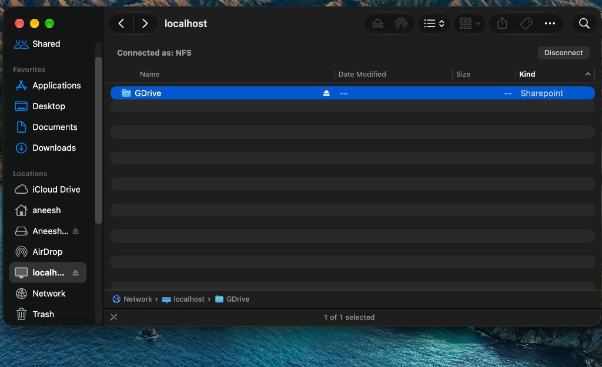
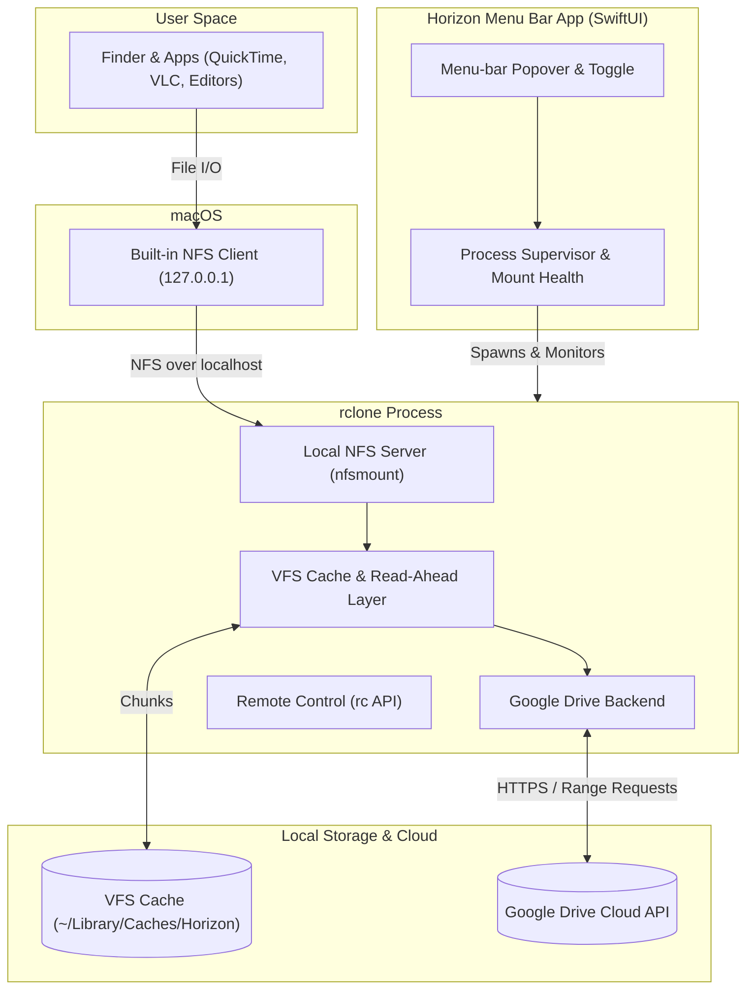

# Horizon

**Horizon** is a lightweight, native macOS menu-bar application that mounts your Google Drive locally in Finder using `rclone`'s high-performance NFS mount (`nfsmount`). It allows you to stream files on demand (such as 4K videos), edit files in place, and perform fast multi-gigabyte transfers with automatic disk caching and background upload syncing.

<p align="center">
  
</p>

---

## Key Features

- **Menu-Bar Resident:** Runs discreetly in your top macOS menu bar (`LSUIElement`) without cluttering the Dock or Cmd+Tab switcher.
- **Native NFS Mounting:** Utilizes macOS’s built-in NFS client and `rclone nfsmount` on localhost—no kernel extensions or third-party FUSE drivers required.
- **On-Demand Streaming:** Reads only the requested bytes with read-ahead caching, making video playback and scrubbing responsive.
- **VFS Disk Cache & Write-Back:** Edits and saves happen instantly in a local chunk cache (`~/Library/Caches/Horizon/rclone`), automatically uploading back to Google Drive in the background.
- **One-Click Control:** Sleek dropdown panel featuring a Connect/Disconnect toggle switch, live status indicators, and an **Open in Finder** shortcut.
- **Safe Teardown & Recovery:** Automatically handles graceful unmounts (`umount`), clears stale mounts on launch, and ensures no orphan processes or locked mounts on exit.

---

## Architecture Overview

Finder communicates directly with macOS's built-in NFS client over `localhost`, which connects to `rclone`'s local NFS server and VFS cache layer. File data flows directly between rclone and Google Drive; Horizon acts as the supervisor and control panel.



---

## Default Mount Configuration

Horizon executes `rclone nfsmount` configured with the following tuned parameters:

| Flag | Value | Purpose |
| :--- | :--- | :--- |
| `Remote` | `gdrive:` | Configured Google Drive remote |
| `Mount Point` | `~/GDrive` | Dedicated local mount folder |
| `--vfs-cache-mode` | `full` | Full chunk caching on disk for streaming and in-place saves |
| `--vfs-read-chunk-streams` | `4` | Concurrent streams for multi-threaded chunk downloads (eliminates NFS timeout) |
| `--vfs-read-chunk-size` | `8M` | Initial chunk read size for instant file opens (<150ms) |
| `--vfs-read-chunk-size-limit` | `off` | Allows chunk doubling for continuous sequential reading (e.g. 4K video) |
| `--vfs-read-wait` | `20ms` | Wait window before seeking to prevent stream thrashing |
| `--vfs-read-ahead` | `128M` | Prefetches sequential video/doc data ahead of read pointer |
| `--buffer-size` | `32M` | In-memory buffer per open file |
| `--cache-dir` | `~/Library/Caches/Horizon/rclone` | Isolated disk cache path |
| `--vfs-cache-max-size` | `50G` | Caps total local disk cache size |
| `--vfs-cache-max-age` | `24h` | Retains untouched cached data for 24 hours |
| `--dir-cache-time` | `72h` | In-memory directory structure cache for zero-lag folder browsing |
| `--poll-interval` | `0` | Disables background polling to eliminate Finder lockups |
| `--vfs-write-back` | `5s` | 5-second delay before queued saves upload to Drive |
| `--drive-chunk-size` | `64M` | Multi-part upload chunk size for faster transfers |
| `--drive-pacer-min-sleep` | `10ms` | Accelerates Google Drive API requests by 10x |
| `--drive-pacer-burst` | `200` | Handles burst metadata requests from macOS QuickLook/Preview |
| `--drive-export-formats` | `webloc` | Exports Google Docs/Sheets as clickable browser shortcuts |
| `--nfs-cache-type` | `disk` | Preserves file handles across restarts |
| `--rc` | `127.0.0.1:5572` | Local remote-control API for transfer stats & queue polling |
| `--log-file` | `~/Library/Logs/Horizon/rclone.log` | Persistent log file |

---

## Prerequisites

1. **macOS Sonoma (14.0+)** or later.
2. **Xcode 16+** with Swift 6 support.
3. **rclone** installed on your system:
   ```bash
   brew install rclone
   ```
4. A Google Drive remote configured in rclone named **`gdrive`**.

---

## Quick Start & Setup

### 1. Configure the Google Drive Remote

If you haven't already created your `gdrive` remote, configure it using your own Google OAuth Desktop Client credentials:

```bash
rclone config create gdrive drive \
  client_id="YOUR_CLIENT_ID" \
  client_secret="YOUR_CLIENT_SECRET" \
  scope="drive"
```
*(Your web browser will open to authenticate with Google).*

Verify the remote is working:
```bash
rclone lsd gdrive:
```

### 2. Build and Run Horizon

1. Clone or open the project folder:
   ```bash
   open Horizon.xcodeproj
   ```
2. In Xcode, select the **Horizon** scheme and choose **My Mac** as the destination.
3. Build and Run (`⌘R`).
4. Click the **Horizon** icon in your macOS menu bar.
5. Switch the **Connect** toggle to **ON**. The drive will mount to `~/GDrive` and appear under **Locations** in Finder!

---

## Verified Benchmarks (Stage 1 Proof)

During Stage 1 validation on Apple Silicon:
- **Write to Mount:** Copied a 2 GB test file into `~/GDrive` in **14.18s** (~151 MB/s into VFS cache), using only **5% CPU**.
- **Read from Mount:** Copied 2 GB out of `~/GDrive` in **13.98s** (~153 MB/s).
- **Video Playback:** Successfully streamed media in **QuickTime Player** and **VLC**.
- **Crash Recovery:** Simulated `pkill -9` cleanly dropped and recovered with `umount -f ~/GDrive` without Finder stalls.

---

## Project Structure

```
Horizon/
├── Horizon.xcodeproj          # Xcode project configuration
├── Horizon/
│   ├── HorizonApp.swift       # App lifecycle & MenuBarExtra scene declaration
│   ├── ContentView.swift      # Menu-bar popover UI & Connect toggle switch
│   ├── DriveManager.swift     # rclone process supervisor, statfs mount checker, unmount
│   ├── DriveState.swift       # State machine (disconnected, connecting, connected, etc.)
│   ├── Assets.xcassets/       # AppIcon & MenuBarIcon template assets
│   ├── Resources/             # Bundled rclone Apple Silicon (arm64) binary & license
│   └── docs/                  # Architecture specifications & stage test logs
└── README.md
```

---

## License

MIT License. See [LICENSE](LICENSE) for details.

